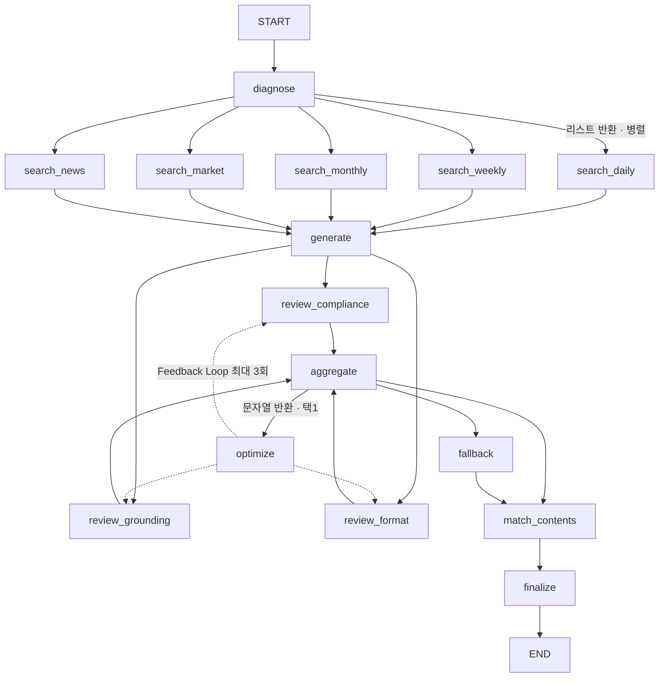

# 디지털PB 브리핑 Agent

KB스타뱅킹 자산관리 투자홈의 브리핑 카드 문구를 LangGraph Agent가 생성하고,
3축 심사를 통과한 뒤 현업 담당자가 승인해 노출하는 구조의 프로토타입.

사내 6주 AI엘리트교육 개인 프로젝트 · 최종발표 2026-10-17

### 공개 저장소 마스킹

`data/cases_41.json` 의 **문구 41건은 그대로**입니다 — 식별자가 아니고
데모 품질에 필요합니다. 내부 시스템 식별자만 가렸습니다.

| 항목 | 원본 | 공개본 |
|---|---|---|
서비스 화면ID | 사내 화면 코드 8종 | `SVC_A` ~ `SVC_G` (+`SVC_E_ALT`) |
앱 네비게이션 | 실제 화면 코드가 박힌 호출 | `window.navi.navigate('/mquics?page={service_id}', …)` |
내부 분석태그 | 서비스명이 박힌 분석 태그 | `상품_디지털PB_투자브리핑_SVC_A` |
정의서 파일명 | 사내 엑셀 파일명 | 제거 (`_meta.source_note` 로 대체) |

구조는 그대로 보이고 실제 값만 빠집니다. 복원 맵은
`data/_service_id_map.local.json` 에 있으며 **커밋하지 않습니다**(`.gitignore`).
사내 반입 시 이 파일로 되돌립니다. 마스킹 후에도 41케이스 커버리지 41/41 입니다.

> **본 저장소의 고객 데이터는 전부 목데이터입니다.** 실제 고객 포트폴리오·
> 고객번호·사번은 사용하지 않았습니다. 시황은 공개 API(Yahoo Finance)와
> 직접 작성한 목 리포트만 씁니다.

---

## 문제 정의

투자 콘텐츠 담당자가 브리핑 문구를 관리할 때 **엑셀 수기 작성 → 개발자
하드코딩 반영**을 거쳐야 해서, 문구를 자주 갱신하기 어렵고 개인화 수준을
높이기도 어렵습니다.

### 문제 정의 — 숫자로

| | 현재 |
|---|---|
투자홈 **MAU** | **13만 명** |
케이스 | **41건 고정** — 매일 시황은 변하는데 문구는 그대로 |
케이스당 평균 고객 | **약 3,000명** |
문구 수정 → 개발 반영 | **최소 7일** |

세 가지가 겹칩니다.

1. **시황은 매일 바뀌는데 문구는 고정입니다.** 41건을 계속 돌려 씁니다
2. **같은 유형 고객 3,000명이 똑같은 문장을 반복해서 봅니다.** 개인화의 단위가
   고객이 아니라 케이스라서, 같은 케이스에 묶이면 어제도 오늘도 같은 문장입니다
3. **고치려면 최소 7일입니다.** 담당자가 엑셀로 쓰고 개발자가 소스에 하드코딩합니다.
   당일 시황을 반영하는 것은 구조적으로 불가능합니다

> 오늘 코스피가 3.4% 내려도, 그 고객이 보는 문장은 **7일 전에 확정된 것**입니다.

### 기대 효과

Agent 가 매일 장 마감 후 41건을 다시 씁니다. **반영 지연 7일 → 1일**이 되고,
같은 케이스라도 그날 시황·보유 종목·관련 기사가 달라지므로 문장이 달라집니다.
담당자는 문구 작성 대신 **검수**를 합니다 — 승인 단위는 그대로 41건입니다.

현재 운영 방식:
- 41개 케이스 문구를 담당자가 엑셀로 작성 → 개발자가 소스에 하드코딩
- 카드 4종(국내/글로벌 시황 · 환율 · 투자 콘텐츠 · 개인 브리핑) 중 **랜덤 1택**
- 갱신 주기가 길어 당일 시황 반영 불가, 문구에 근거 없음

## 해결 방식

| | 현재 | Agent |
|---|---|---|
| 카드 선택 | 랜덤 4택1 | 스코어링 — 왜 골랐는지 숫자로 남음 |
| 문구 | 고정 41건 · 74자 | 당일 시황·보유종목 반영 생성 · 40~220자 |
| 근거 | 없음 | **시세 + 리포트 + 당일 뉴스 3층** |
| 출처 확인 | 불가 | **①②③ 클릭 → 해당 리포트·기사로 이동** |
| 관련 콘텐츠 | 없음 | 보유 종목 뉴스 + KB Think 콘텐츠 |
| 품질 보증 | 담당자 눈 | 3축 자동 심사 + 재작성 루프 + 담당자 승인 |
| 실패 시 | — | 41케이스 원본 문구로 폴백 |

**투자권유는 하지 않습니다. 설명과 안내까지가 범위입니다.**

### 산출물 (2026-10-12 실제 생성물)

```
고객님 투자자산은 839,000원 감소했어요.
KODEX 반도체가 -624,000원으로 하락분의 대부분을 만들었어요.
이날 반도체가 업종별로 가장 부진했고 국내 반도체 밸류체인 전반에
차익 실현이 번졌어요 ①.
삼성전자 주가 부진을 다룬 반도체 투자 리포트도 관련 기사로 확인할 수 있어요 ②.
KODEX 반도체 비중이 42%라 업종 조정의 영향이 커졌어요.

   ① [리포트] 반도체 투심 위축에 코스피 급락        KB Think · 2026-10-12  ↗
   ② [뉴스]   100조원 영업이익에도 삼성전자 주가 왜… 세계일보 · 2026-10-12  ↗
```

같은 고객에게 현재 방식이 내보내는 문구는 다음 한 줄입니다.

```
미국 시장 전망은 긍정적이지만, 투자자산은 5일 전보다 839,000원 감소했어요.
```

---

## 운영 구조 — Batch / Runtime 2계층

```
[Batch]  매일 장 마감 후
   Agent 문구 생성 → 3축 Validation → 어드민 검수(HITL) → 승인분만 서빙 큐 적재

[Runtime] 고객 투자홈 진입
   승인된 케이스 문구 선택 → 고객 수치 슬롯 치환 → 카드 노출   ※ LLM 호출 없음
```

금소법상 투자 문구는 사람 책임 하에 노출되어야 하므로 **고객 요청 경로에
LLM이 없습니다.** 검수 단위는 고객이 아니라 **케이스**입니다.

---

## 아키텍처



`add_conditional_edges`의 **반환 타입이 동작을 가릅니다.**

| 반환 | 동작 | 사용처 |
|---|---|---|
| 리스트 `["a","b"]` | 해당 노드 **병렬 실행** | `route_after_diagnose` |
| 문자열 `"a"` | **택1** | `route_after_review` |

### 적용한 LangGraph 패턴

| 구간 | 패턴 | 선택 이유 |
|---|---|---|
| diagnose → search | Routing + Parallel | 검색 대상이 고정이고 상호 독립 |
| search → generate | Chaining | generate가 검색 결과를 입력으로 사용 |
| generate → review | Parallel (Jury) | 규제 위반 / 할루시네이션 / 형식 위반은 서로 다른 실패 유형 |
| review → optimize | Evaluator-Optimizer | 지적사항 반영 후 재심사 |
| fallback | Graceful Degradation | 생성이 실패해도 서비스가 죽지 않아야 함 |

---

## 출처를 고객의 언어로

grounding 심사는 `[일간-261012]` 같은 **기계가 대조할 수 있는 라벨**이 필요하고,
고객은 그 코드를 읽을 이유가 없습니다. 둘은 목적이 다르므로 같은 문자열을
쓰지 않습니다.

| 칸 | 용도 | `[portfolio]` | 출처 코드 |
|---|---|---|---|
`advice` | 검수 화면 · 감사 추적 · grounding 심사 | 있음 | `[일간-261012]` |
`advice_display` | **고객 노출** | **없음** | `①②③` |
`sources` | 고객이 누르는 출처 칩 | — | 제목 · 요약 · 발행처 · URL |

`[portfolio]`는 자체 계산값이라 출처가 없습니다. 붙여도 고객에게 아무 정보를
주지 않으면서 문장만 어지럽히므로 **고객 화면에서 완전히 지웁니다.**

고객이 ①을 누르면 그 출처의 **엔드서비스로 이동**합니다 — 리포트는 KB Think
페이지, 뉴스는 기사, 시장지표는 투자홈 시장지표 화면입니다.
변환은 [src/sources.py](src/sources.py) 한 곳에서만 합니다.

## 근거 3층

```
market_tool   숫자   코스피 -3.39% · 원/달러 1,333원          [시장-^KS11]
retriever     해설   반도체 업종에 차익 실현이 번졌다            [일간-261012]
news_tool     사건   '반도체 약세' 코스피 6,500 내줘 (MBC뉴스)   [뉴스-1]
```

고객이 알고 싶은 것은 "얼마나 변했나"가 아니라 **"왜 변했나"** 입니다.
금액은 이미 화면에서 봅니다. 뉴스가 그 "왜"에 가장 가깝습니다.

뉴스는 **보유 종목 비중 순**으로 찾습니다 — 비중이 큰 종목이 변동 설명력도
큽니다. 종목명을 그대로 검색하면 `KODEX` 같은 상품 브랜드가 검색을 망치므로
섹터 어휘로 번역합니다(`news_tool.query_for`).

## ★ Feedback Loop을 구조적으로 성립시킨 방법

이 프로젝트에서 가장 찾기 어려웠던 버그이고, 설계의 핵심입니다.

**문제.** `reviews`는 세 심사 노드가 병렬로 쓰는 칸이라 reducer가 반드시
있어야 합니다(없으면 `InvalidUpdateError: Can receive only one value per step`).
그런데 reducer를 `operator.add`로 두면 **그 칸을 비울 수가 없습니다.**

```python
operator.add(["1회차 실패기록"], []) == ["1회차 실패기록"]
```

노드가 `reviews: []`를 반환해도 누적분이 그대로 남습니다. 결과:

```
1회차: compliance 실패 → 재작성
2회차: compliance 통과 · grounding 통과 · format 통과
       그런데 1회차 실패기록이 남아 all(passed)가 여전히 False
→ 3회 돌고 폴백. 반려된 문구는 절대 되살아나지 못한다.
```

**설계 원칙.** 하나의 State 칸에 *"지금 판정에 쓸 값"* 과 *"남겨야 할 이력"* 을
같이 담으려 하면 실패합니다. 둘은 수명이 다르므로 **칸을 둘로 나눕니다.**

```python
reviews        : Annotated[list, keep_latest_round]   # 현재 회차만. 판정에 쓴다
review_history : Annotated[list, operator.add]        # 전 회차 누적. 감사 추적
```

`keep_latest_round`는 각 심사 결과에 박힌 `revision`을 보고 **스스로 오래된
것을 버립니다.** 노드가 "비워야 한다"를 기억할 필요가 없습니다 — 기억에
의존하는 규칙은 언젠가 빠뜨리고, 빠뜨린 줄도 모릅니다.

```python
def keep_latest_round(old, new):
    merged = list(old or []) + list(new or [])
    if not merged:
        return []
    latest = max(r.get("revision", 0) for r in merged)
    return [r for r in merged if r.get("revision", 0) == latest]
```

금소법상 감사 추적이 필요하므로 이력은 버리지 않습니다. 분리할 뿐입니다.
구현과 자기검증은 [src/reducers.py](src/reducers.py), 회귀 테스트는
[tests/test_loop.py](tests/test_loop.py)의 5번입니다.

---

## 3축 Validation

| 축 | 담당 | 무엇을 보는가 |
|---|---|---|
`review_compliance` | **Rule 1차 + LLM 2차** | 금지어는 규칙이 결정적으로 잡고, 우회적 권유·암시적 미래 단정만 LLM이 본다 |
`review_grounding` | Rule + LLM | 문장 단위. `[portfolio]`는 자체 계산값이라 면제, 외부 태그는 evidence에 그 doc이 있는지 + 본문이 주장을 지지하는지 |
`review_format` | **전부 Rule** | 글자수(태그 제외 40~220자) · 문장 수(≤6) · 슬롯 유효성 · 금액 표기 |

41케이스의 13~74자는 **현재 카드 UI 제약**이지 설계 제약이 아닙니다. 채팅형으로
가면서 `.env`의 `ADVICE_MIN_LEN`/`ADVICE_MAX_LEN`을 따릅니다. 74자로는
"변동 + 기여 + 원인"이 들어가지 않아 LLM이 계속 글자수로 반려됐고(실측 4라운드 후
폴백), 한도를 올린 뒤 **LLM 호출이 23→15회로 줄고 폴백이 사라졌습니다.**
제약을 풀었더니 비용이 내려간 역설적인 결과입니다.
폴백 문구에는 여전히 원본 제한이 적용됩니다 — 현업이 그 틀에서 쓴 문장이기 때문입니다.

`change_type`이 `자산없음`·`자산생김`이면 시황을 인용하지 않으므로
**grounding을 면제**합니다. 일괄 적용하면 통과할 수 없는 문구로 루프만 돕니다.

### Rule / LLM 경계

규제 영역이라 **추적 가능해야 하는 판단은 전부 Rule**입니다.

| 영역 | 담당 |
|---|---|
| 41케이스 판정, 수익률·비중 계산, 단기시장전망 판정 | **Rule** |
| 금지어 매칭, 글자수 검사, 슬롯 유효성, 금액 표기 | **Rule** |
| 문구 생성, 톤 조정, 재작성 | **LLM** |
| 애매한 표현의 투자권유 여부 2차 판정 | **LLM** (Rule이 거른 뒤 회색지대만) |

---

## 실행

### 설치

시스템 `python3`가 3.7이면 돌지 않습니다(PEP 585 빌트인 제네릭 사용).
**Python 3.10 이상**이 필요합니다.

```bash
python3.12 -m venv ~/.venvs/elite
~/.venvs/elite/bin/pip install -r requirements.txt

cp .env.example .env     # 키를 채운다
```

### 키 없이 실행 (발표장 안전망)

```bash
USE_LLM=false ./run_local.sh agent
```

`USE_LLM=false`면 **API 키 없이 전체 흐름이 돕니다.** Rule 생성 경로도
3축을 통과하도록 만들어 뒀습니다 — 폴백 0건으로 완주합니다.

### LLM 사용

```bash
# .env 에 OPENAI_API_KEY 와 USE_LLM=true
./run_local.sh agent
```

키가 없는데 `USE_LLM=true`면 경고만 내고 `False`로 내려갑니다. 죽지 않습니다.

### 데모 앱 (주력)

```bash
./run_local.sh mcp &      # ① MCP 서버 (없어도 되지만 있으면 MCP 경로로 돈다)
./run_local.sh app        # ② streamlit run app/briefing_app.py
```

최종발표 요건(교재 p18)은 **"실제 입력을 넣고 Agent가 실행되는 화면"** 을 필수로
요구합니다. 이 앱은 버튼을 누르면 **LangGraph가 실제로 돌고**, 노드가 끝날 때마다
왼쪽 로그가 늘고 오른쪽 고객 화면이 채워집니다.

| 모드 | 동작 |
|---|---|
**승인본 재생 (Runtime)** | `output/approved/*.json`을 즉시 그림. **LLM 호출 0회** — 실제 고객 진입 경로 |
**지금 생성 (Batch)** | 그래프를 실제로 실행. 전날 배치에서 일어나는 일 |

왼쪽에 3축 심사 결과, 카드 스코어링 막대, 실행 로그, 어드민이 받는 JSON이 뜹니다.

### 고객은 자유 입력을 하지 않습니다 — 질문 칩

채팅 UI지만 **입력창이 없습니다.** 미리 정의된 질문 칩만 누를 수 있고,
답은 이미 만들어진 `card_spec` 안에 있습니다.

```
어느 자산이 움직였어? / 내 자산 구성 괜찮아? / 관련 뉴스 보여줘
더 읽어볼 글 있어? / 환율은 어때?
```

이유는 세 가지입니다.

1. **금소법** — 고객이 무엇을 물을지 모르면 답을 미리 검수할 수 없습니다
2. **Runtime LLM** — 자유 질문은 고객 수만큼 호출입니다
3. **기획 정합** — 이 프로젝트가 푸는 문제는 "문구 관리 병목"이지 "고객 상담"이
   아닙니다. 범위를 넓히면 둘 다 얕아집니다

부수 효과로 **화면이 짧아집니다.** 기본은 4블록(시황·변동·설명·근거)만 펼치고
나머지는 칩 뒤로 보냅니다. 길이 문제와 상호작용 문제가 같이 풀립니다.

### 데모 뷰어 (백업)

```bash
./run_local.sh agent          # 카드 스펙을 output/approved/*.json 으로 생성
./run_local.sh viewer         # 그 JSON 을 demo/viewer.html 에 인라인 주입
open demo/viewer.html
```

Streamlit이 막히는 환경을 위한 백업입니다. AS-IS 비교는 이쪽이 낫습니다.
좌우 2분할이고, `fetch`가 막히는 환경을 믿지 않으므로 **데이터를 HTML에 인라인**합니다.

**왼쪽 (AS-IS)** — 실제 투자홈 화면(`asis.png`)을 재현했습니다. 탭바, 자산 영역,
`디지털 PB가 알려드려요` 카드까지 같은 구조입니다. 핵심은 **카드 한 장이 아니라
"자리 하나 + 후보 4종"** 이라는 점입니다. 네 슬롯을 모두 그리고 어느 것이 뽑혔는지
표시하며, `🎲 카드 다시 추첨`을 누르면 같은 고객에게 다른 카드가 뜹니다.
랜덤의 문제를 말로 설명하지 않고 **보여주는** 것이 이 패널의 목적입니다.

**오른쪽 (TO-BE)** — PB 상담 순서로 재구성한 채팅입니다.

```
🧑 오늘 내 투자자산 어때?
✦ [시황 보드]              코스피 · S&P500 · 원/달러 · 내 자산을 한 화면에
✦ [내 투자자산]            큰 숫자 + 진단 배지(하락 · 과편중 · 최대비중 42%)
✦ [무슨 일이 있었나요]      생성 문구 + ①②
✦ [어느 자산이 움직였나]    종목별 비중 바 + 기여액 (40% 넘으면 앰버)
✦ [제가 본 점검 포인트]  ★  집중도 · 환율 노출 · 방문 간격
✦ [설명의 근거]            출처 카드 → 클릭 시 이동
✦ [내 보유 종목 관련 오늘 기사]
✦ [이어서 읽어볼 콘텐츠]
✦ [엔드서비스 CTA]
```

### 화면 규칙

- **주색은 보라(#6B4EFF)** — 실제 투자홈이 보라 계열입니다. 노랑은 보조 강조에만
- **상승 = 빨강 / 하락 = 파랑** — 한국 증시 관례. 반대로 칠하면 오독을 만듭니다
- 각 블록에 섹션 헤더를 달아 글이 줄줄이 이어지지 않게 끊습니다

### ★ "제가 본 점검 포인트"

콘텐츠 추천이 아니라 **PB 제안**으로 읽히게 만드는 블록입니다.
`card_spec.diagnosis`(Rule 진단값)로 조립하며 **새 LLM 호출이 없습니다.**

| 조건 | 노출 |
|---|---|
`gap_type == 과편중` | 한 종목에 N%가 몰려 있어요 — 기여 종목명과 함께 |
`gap_type == 과보수` | 위험자산 비중이 하우스뷰 권고(40%)보다 낮아요 |
해외 비중 ≥ 30% | 환율이 함께 움직여요 — 환헤지 여부로 체감이 달라요 |
`days_since ≥ 30` | N일 만에 오셨어요 — 기간을 나눠 보면 원인을 찾기 쉬워요 |

**투자권유가 되지 않도록 "확인해 보세요"까지만 씁니다.** 보유 구조와 하우스뷰
권고의 차이를 설명할 뿐이고, 판단은 고객에게 남깁니다.

> **채팅형 UI는 연출입니다. Runtime에 LLM 호출이 없습니다.**
> 문구는 전날 Batch에서 생성·심사·승인을 거친 JSON이고, 고객 진입 시점에는
> 그것을 순차로 펼쳐 보여줄 뿐입니다. 금소법상 투자 문구는 사람 책임 하에
> 노출되어야 하므로 고객 요청 시점에 모델을 부르지 않습니다.

### 개별 모듈

```bash
./run_local.sh config     # 설정·키 로딩 상태 (키는 마스킹 출력)
./run_local.sh market     # 실시간 지수·환율 조회
./run_local.sh search     # 리포트 벡터 검색
./run_local.sh cases      # 41케이스 판정 + 전 조합 커버리지 검증
./run_local.sh reducer    # ★ Feedback Loop reducer 자기검증
./run_local.sh test       # 루프 회귀 테스트 6종
./run_local.sh news       # 보유 종목 관련 기사 조회
./run_local.sh sources    # 내부 태그 → 대고객 출처 칩 변환
./run_local.sh lab        # 패턴 비교 (chaining / parallel / orchestrator)
```

---

## 기술 스택

| 요소 | 사용 |
|---|---|
LangGraph | `StateGraph` · `add_conditional_edges` · 커스텀 reducer · `InMemorySaver` |
LangChain | `init_chat_model` · `with_structured_output` (Pydantic) |
RAG | `InMemoryVectorStore` + `text-embedding-3-small`, 문단 청킹, 메타데이터 출처 |
LLM | `gpt-5.5` (구조화 출력 · temperature 0) |
**MCP** | `FastMCP` 서버(`kb-market`, 도구 6종) + `MultiServerMCPClient` · streamable-http |
Tool | Yahoo Finance chart — 코스피 · 코스닥 · 원/달러 · SOX · S&P500 · 나스닥 · VIX |
Tool | Google News RSS — 보유 종목·섹터 한국어 기사 (키 불필요) |
Observability | Langfuse (키가 있으면 활성) |

### 왜 Chroma가 아니라 InMemoryVectorStore인가

교육과정 노트북 21개를 실측하면 Chroma 사용 0건, `InMemoryVectorStore` 25건
입니다. 리포트가 8건뿐이라 영속 인덱스의 이점(재인덱싱 회피)보다 비용
(`.chroma` 캐시 꼬임, 멱등성 관리)이 큽니다. 8건 임베딩은 수 초입니다.

### 왜 FMP가 아닌가

FMP 무료 등급으로는 이 프로젝트가 필요한 세 가지가 전부 막힙니다
(2026-10-12 실측).

| 심볼 | 결과 |
|---|---|
`AAPL` · `SPY` · `EURUSD` | 200 OK |
`USDKRW` · `QQQ` · `SOXX` · `EWY` | 402 Premium |
`^KS11`(코스피) · `/forex` | 404 |
`/api/v3/*` | 2025-08-31 종료 (레거시) |

카드 4종이 쓰는 국내 시황 · 환율 · 반도체가 다 비어 있습니다. 키가 없고
세 가지가 모두 되는 Yahoo Finance로 갔습니다. 네트워크가 막히면 `stale=True`로
마지막 값을 반환하고 그래프는 끝까지 돕니다.

## Tool 을 MCP 서버로 분리

`market_tool.py` · `news_tool.py` 를 그래프에서 직접 import 해도 동작합니다.
그러면 **이 Agent 안에서만 쓸 수 있습니다.**

MCP 서버로 빼면 같은 시황·뉴스 조회를 다른 팀 Agent 가 그대로 붙여 씁니다.
투자홈 브리핑, PB 상담 봇, 리포트 요약기가 **같은 시세 정의**를 쓰게 됩니다 —
"단기 전망 좋음/보통/나쁨"의 임계값이 팀마다 달라지는 사고를 막습니다.

```
[이 Agent]  ─┐
[PB 상담봇] ─┼─→ kb-market MCP ─→ Yahoo Finance / Google News
[리포트요약] ─┘
```

### 도구 6종 (`mcp_servers/market_server.py`)

| 도구 | 하는 일 |
|---|---|
`get_market_snapshot` | 지수·환율 7종 현재가·등락률 |
`get_market_view` | 단기 전망 좋음/보통/나쁨 판정 (Rule — 같은 수치면 같은 판정) |
`get_market_evidence` | 시황을 근거(evidence) 형식으로 변환 |
`search_news` | 한국어 기사 검색 (최근 7일) |
`news_for_holdings` | 보유 종목 → 섹터 어휘 번역 후 기사 조회 |
`sector_query_for` | 종목명 → 검색어 매핑 확인용 |

**고객 데이터는 서버로 넘기지 않습니다.** `news_for_holdings` 는 종목명만 받고,
보유 금액·비중·고객번호는 Agent 쪽에 남습니다.

### MCP 가 죽어도 데모는 돕니다

MCP 는 별도 프로세스입니다. 포트가 막히거나 서버가 안 떠 있으면 그래프가
멈출 수 있고, 발표장에서 그건 치명적입니다.

```
USE_MCP=true →  kb-market MCP 호출
                ↓ 실패 (서버 없음 / 타임아웃 / 도구 오류)
             →  market_tool · news_tool 직접 호출
```

어느 경로로 갔는지 로그에 찍힙니다 — `시황 지표 3건 (MCP · Yahoo Finance)`.
발표에서 "지금 MCP 로 돌고 있습니다"를 보여줄 수 있어야 하기 때문입니다.

```bash
./run_local.sh mcp        # 서버 기동 (127.0.0.1:8765/mcp)
./run_local.sh mcptest    # 도구 6종 호출 확인
```

교육과정 `w4_nb04`(로컬 MCP 서버 만들기) · `w5_nb01b`(RAG 를 MCP 로 내보내기)와
같은 방식입니다 — `FastMCP` + `streamable-http` + `MultiServerMCPClient`.

### 왜 Google News RSS인가

| 후보 | 결과 (2026-10-12 실측) |
|---|---|
| **Google News RSS** | 한국어 기사 100건 · 키 불필요 · 당일 기사 |
| Yahoo Finance search | 영문 기사만. `005930.KS`는 0건 |
| GDELT `sourcelang:korean` | 0건 |
| Naver 뉴스 API | client id/secret 필요 |

대고객 문구에 영문 기사를 링크할 수 없어서 Google News RSS로 갔습니다.
제목·발행처·링크까지만 쓰고 본문은 크롤링하지 않습니다 — 저작권 문제가 있고
링크로 보내는 것이 고객에게도 낫습니다.

---

## 파일

```
app/briefing_app.py    ★ 데모 앱 — 그래프를 실제로 돌리며 고객 화면을 채운다
mcp_servers/
  market_server.py     ★ kb-market MCP 서버 — 시황·뉴스 도구 6종
src/
  reducers.py          ★ Feedback Loop 을 성립시키는 reducer + 자기검증
  followups.py         질문 칩 — 고객이 자유 입력 없이 대화하는 방법
  mcp_client.py        MCP 호출 + 직접 호출 폴백
  briefing_agent.py    메인 LangGraph — 15노드
  sources.py           ★ 내부 태그 → 대고객 출처 칩 (①②③ + 링크)
  case_router.py       41케이스 판정. 전 조합 커버리지 41/41 검증
  market_tool.py       시황 Tool (Yahoo Finance) — 지수·환율·VIX 7종
  news_tool.py         뉴스 Tool (Google News RSS) — 보유 종목·섹터 기사
  retriever.py         리포트 벡터 검색 + 키워드 폴백
  prompts.py           프롬프트 분리 — 코드에 하드코딩하지 않는다
  llm.py               LLM 래퍼. 예외를 밖으로 던지지 않고 호출 수를 센다
  content_matcher.py   KB Think 콘텐츠 스코어링 매칭
  config.py            .env 로딩 · 문구 길이 한도 · 키 없으면 USE_LLM 을 내린다
data/
  cases_41.json        41케이스 원문 + 서비스 8종 + 슬롯/글자수 제한
  kbthink_contents.json 콘텐츠 50건 + 태그 19종 (2026-10 최신화, summary·url 포함)
  reports/             시황 목 리포트 8건 — frontmatter 에 url·summary
tests/test_loop.py     루프 회귀 6종
lab/pattern_lab.py     패턴 비교 — chaining / parallel / reducer 없는 버그 / orchestrator
demo/
  viewer.html          채팅형 좌우 비교 뷰어 (데이터 인라인, 단일 파일)
  build_viewer.py      output/approved/*.json → viewer.html 주입
docs/
  PLAN_2610.md         2026-10-12 기획 개정 — 무엇을 왜 바꿨는지
  WORKPLAN.md          단계별 작업 지시서
code/                  교육과정 노트북 21개 (참고용, 원본 보존)
```

---

## 한계와 다음 단계

- **HITL 미구현** — `interrupt()` + `Command(resume)`로 담당자 승인 게이트를
  `finalize` 앞에 넣는 것이 다음 작업입니다. 교육과정이 가르친 것은
  `interrupt_before` 방식(정적)이라 동적 인터럽트는 새 API입니다
- **배치 러너 미구현** — 41케이스 순회 + `output/pending` 적재
- **AS-IS 패널은 캡처 재현**이지 실제 앱이 아닙니다. 발표 시 실물 캡처를 함께
  쓸 경우 금액 마스킹을 동일하게 적용할 것
- **n8n 미사용** — 교재 p12가 명시한 스택 중 하나가 빠졌습니다 (MCP 는 적용 완료)
- **목데이터 글 12건은 링크가 섹션 랜딩으로 갑니다** — 실제 기사가 없는
  목데이터라 `url_intended`에 원래 경로를 남기고 `kbthink.com/investment.html`로
  보냅니다. 기존 38건은 실제 페이지(HTTP 200 확인)입니다
- **뉴스 매체 화이트리스트 없음** — Google News는 매체를 가리지 않습니다.
  대고객 노출이므로 신뢰도 관리가 필요할 수 있습니다
- **뉴스 저작권** — 제목·링크만 쓰므로 인용 범위로 보이지만 법무 확인 필요
- **엔드서비스 링크가 두 종류** — `cases_41.json`의 `window.navi.navigate(...)`는
  앱 내부 네비게이션이고, 뉴스·KB Think는 외부 URL이라 처리 경로가 다릅니다
- 41케이스 중 `CASE12=CASE29`, `CASE15=CASE32`, `CASE18=CASE35`,
  `CASE21=CASE38` 네 쌍이 문구가 완전히 동일합니다(30일 초과인데
  "오랜만에 방문" 미반영). 원본 데이터 이슈로 미해결
- `CASE1~9`는 `verified: false` — 화면 캡처에서 옮긴 값이라 원문 대조 필요
- `curAmt` 슬롯은 `_meta.slots`에 정의돼 있으나 41건 전체에서 사용 0회
- 국내/해외 전망 중 무엇을 쓸지는 보유자산 지역 비중으로 추정 중
