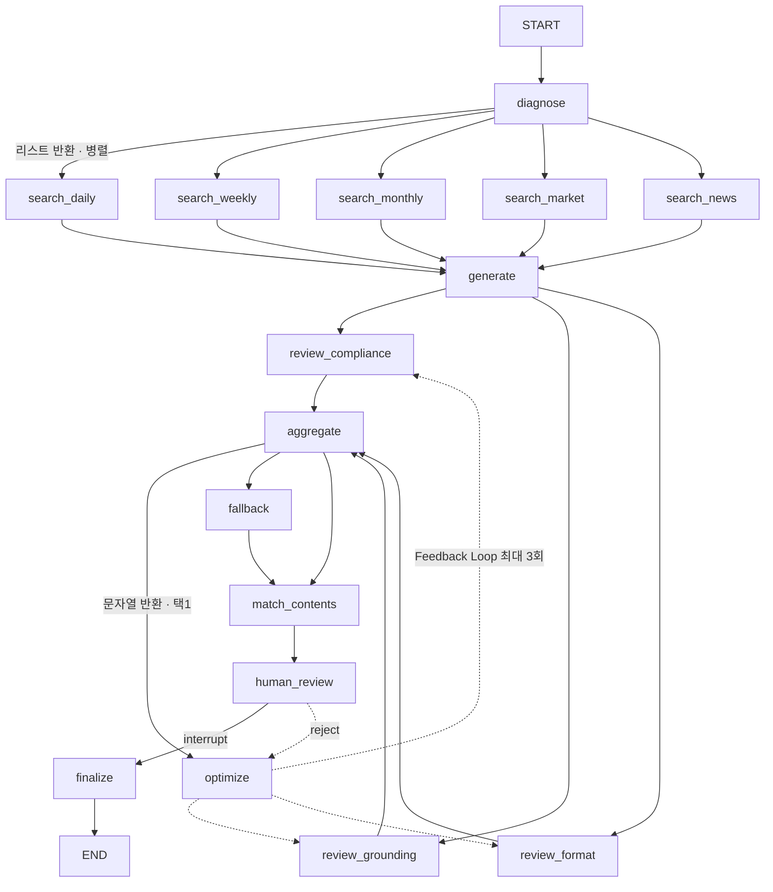

# 디지털PB 브리핑 Agent

KB스타뱅킹 자산관리 투자홈의 브리핑 카드 문구를 LangGraph Agent가 생성하고,
3축 심사와 담당자 승인을 거쳐 노출하는 프로토타입.

사내 6주 AI엘리트교육 개인 프로젝트 · 최종발표 2026-10-17

> 고객 데이터는 전부 목데이터입니다. 시황은 공개 시세, 뉴스는 공개 기사입니다.
> 사내 서비스 화면ID·앱 네비게이션 경로·내부 분석태그는 `SVC_*` 로 마스킹했습니다.

---

## 1. 문제

| 지표 | 값 | 출처 |
|---|---|---|
투자홈 **MAU** | **130,843명** | 2026-08 |
투자 브리핑 카드 **일평균 노출** | **9,623건** | 일평균 PV |
브리핑 문구 | **41개 케이스 고정** | 현업 정의서 |
**케이스당 평균 고객** | **약 3,191명** | MAU ÷ 41 |
문구 수정 → 개발 반영 | **최소 7일** | 담당자 엑셀 → 개발 하드코딩 |

> 하루 **9,623번** 노출되는 자리에, **7일 전에 확정된 문장**이 걸려 있습니다.
> 같은 케이스에 묶인 **3,191명**은 어제도 오늘도 같은 문장을 봅니다.

카드 4종(시황·환율·투자콘텐츠·개인브리핑) 중 **랜덤 1택**이라 고객 상황과
무관하게 뽑히고, 문구에 근거가 없습니다.

> 오늘 코스피가 3.4% 내려도, 그 고객이 보는 문장은 **7일 전에 확정된 것**입니다.

## 2. 해결

| | 현재 | Agent |
|---|---|---|
카드 선택 | 랜덤 4택1 | 스코어링 — 왜 골랐는지 숫자로 남음 |
문구 | 고정 41건 | 당일 시황·보유종목·기사 반영 생성 |
근거 | 없음 | 시세 + 리포트 + 당일 기사 3층 |
출처 확인 | 불가 | ①②③ 클릭 → 해당 리포트·기사로 이동 |
품질 보증 | 담당자 눈 | 3축 자동 심사 + 재작성 루프 + 담당자 승인 |
실패 시 | — | 41케이스 원본 문구로 폴백 |
반영 지연 | 7일 | **1일** |

**투자권유는 하지 않습니다. 설명과 안내까지가 범위입니다.**

### 실제 생성물 (2026-10-12)

```
고객님 투자자산은 839,000원 감소했어요.
KODEX 반도체가 -624,000원으로 하락분의 대부분을 만들었어요.
이날 반도체가 업종별로 가장 부진했고 국내 반도체 밸류체인 전반에
차익 실현이 번졌어요 ①.
삼성전자 주가 부진을 다룬 반도체 투자 리포트도 관련 기사로 확인할 수 있어요 ②.

   ① [리포트] 반도체 투심 위축에 코스피 급락        KB Think · 2026-10-12  ↗
   ② [뉴스]   100조원 영업이익에도 삼성전자 주가 왜… 세계일보 · 2026-10-12  ↗
```

같은 고객에게 현재 방식이 내보내는 문구:

```
미국 시장 전망은 긍정적이지만, 투자자산은 5일 전보다 839,000원 감소했어요.
```

## 3. 운영 구조 — Batch / Runtime 2계층

```
① 전날 밤 18:00  [Batch]
   Agent 문구 생성 → 3축 심사 → 재작성 루프 → 담당자 검수 → 승인분만 적재

② 다음날        [Runtime]
   승인된 JSON 을 슬롯 치환해 노출            ※ LLM 호출 없음
```

금소법상 투자 문구는 **사람 책임 하에** 노출되어야 하므로 고객 요청 경로에
LLM이 없습니다. 검수 단위는 고객이 아니라 **케이스**입니다 — 1건 승인이
같은 유형 **약 3,191명**의 화면을 바꿉니다. 41건을 검수하면 MAU 13만 명
전체에 반영됩니다. **이 비율이 이 구조가 성립하는 이유입니다.**

고객은 **자유 입력을 하지 않습니다.** 미리 승인된 질문 칩만 누릅니다
(무엇을 물을지 모르면 답을 미리 검수할 수 없습니다).

## 4. 아키텍처



`add_conditional_edges` 의 **반환 타입이 동작을 가릅니다** — 리스트는 병렬,
문자열은 택1.

### 입력 — 이 세 가지만 받습니다

| | 내용 | 출처 |
|---|---|---|
`portfolio` | 종목·비중·전일대비 증감·지역, 평가액, 경과일수 | 투자홈 자산 전문 |
`profile` | WMTI · 연령대 · 위험성향 · 난이도 | 고객 프로파일 |
`recent_views` | 최근 본 콘텐츠 해시태그 | KB Think 열람 이력 |

나머지(시황·리포트·뉴스·41케이스·콘텐츠)는 **Agent 가 스스로 끌어옵니다.**

### State — reducer 가 설계의 핵심

| 칸 | 역할 | reducer |
|---|---|---|
`evidence` | 근거 — 검증 대상 | `operator.add` (병렬 fan-in) |
`reviews` | 현재 회차 심사 | **`keep_latest_round`** |
`review_history` | 전 회차 누적 — 감사 추적 | `operator.add` |
`logs` | 실행 로그 | `operator.add` |

### 적용한 패턴

| 구간 | 패턴 | 이유 |
|---|---|---|
diagnose → search | Routing + Parallel | 검색 대상이 고정이고 상호 독립 |
search → generate | Chaining | generate 가 검색 결과를 입력으로 씀 |
generate → review | Parallel (Jury) | 규제 위반·할루시네이션·형식 위반은 다른 실패 유형 |
review → optimize | Evaluator-Optimizer | 지적사항 반영 후 재심사 |
human_review | Human-in-the-Loop | `interrupt()` + `Command(resume)` |
fallback | Graceful Degradation | 생성이 실패해도 서비스가 죽지 않아야 함 |

---

## 5. ★ Feedback Loop 을 구조적으로 성립시킨 방법

가장 찾기 어려웠던 버그이고 설계의 핵심입니다.

**문제.** `reviews` 는 세 심사 노드가 병렬로 쓰는 칸이라 reducer 가 필요합니다
(없으면 `InvalidUpdateError`). 그런데 `operator.add` 로 두면 **비울 수가 없습니다.**

```python
operator.add(["1회차 실패기록"], []) == ["1회차 실패기록"]
```

노드가 `reviews: []` 를 반환해도 누적분이 남습니다. 결과:

```
1회차: compliance 실패 → 재작성
2회차: 세 축 전부 통과 — 그런데 1회차 실패기록이 남아 all(passed)가 False
→ 3회 돌고 폴백. 반려된 문구는 절대 되살아나지 못한다.
```

**설계 원칙.** 하나의 State 칸에 *"지금 판정에 쓸 값"* 과 *"남겨야 할 이력"* 을
같이 담으려 하면 실패합니다. 수명이 다르므로 **칸을 둘로 나눕니다.**

```python
def keep_latest_round(old, new):
    """같은 회차의 심사 결과만 남긴다."""
    merged = list(old or []) + list(new or [])
    if not merged:
        return []
    latest = max(r.get("revision", 0) for r in merged)
    return [r for r in merged if r.get("revision", 0) == latest]
```

각 심사 결과에 `revision` 을 박습니다. `optimize` 가 회차를 올리면 reducer 가
**스스로 이전 회차를 버립니다.** 노드가 "비워야 한다"를 기억할 필요가 없습니다 —
기억에 의존하는 규칙은 언젠가 빠뜨리고, 빠뜨린 줄도 모릅니다.

감사 추적은 `review_history` 가 따로 보존합니다.
구현·자기검증 [src/reducers.py](src/reducers.py) · 회귀 [tests/test_loop.py](tests/test_loop.py)

## 6. 3축 Validation

| 축 | 담당 | 무엇을 보는가 |
|---|---|---|
`review_compliance` | **Rule 1차 + LLM 2차** | 금지어는 규칙이 결정적으로, 우회적 권유·암시적 미래 단정만 LLM 이 |
`review_grounding` | Rule + LLM | 문장 단위. `[portfolio]` 는 면제, 외부 태그는 evidence 대조 + 본문 지지 여부 |
`review_format` | **전부 Rule** | 글자수(태그 제외 40~220) · 문장수 · 슬롯 · 금액 표기 |

`change_type` 이 `자산없음`·`자산생김` 이면 시황을 인용하지 않으므로
**grounding 을 면제**합니다. 일괄 적용하면 통과할 수 없는 문구로 루프만 돕니다.

규제 영역이라 **추적 가능해야 하는 판단은 전부 Rule** 입니다 — 41케이스 판정,
수익률·비중 계산, 시장전망 판정, 금지어 매칭, 글자수·슬롯 검사.
LLM 은 문구 생성·재작성과 회색지대 2차 판정만 합니다.

## 7. 출처를 고객의 언어로

grounding 심사는 `[일간-261012]` 같은 **기계가 대조할 라벨**이 필요하고
고객은 그 코드를 읽을 이유가 없습니다. 목적이 다르므로 분리합니다.

| 칸 | 용도 | `[portfolio]` | 출처 코드 |
|---|---|---|---|
`advice` | 검수·감사 추적·grounding 심사 | 있음 | `[일간-261012]` |
`advice_display` | **고객 노출** | **없음** | `①②③` |
`sources` | 고객이 누르는 출처 칩 | — | 제목·요약·발행처·URL |

`[portfolio]` 는 자체 계산값이라 출처가 없습니다. 붙여도 고객에게 정보를 주지
않으면서 문장만 어지럽히므로 **고객 화면에서 지웁니다.** 시장지표도 시황 보드에
숫자가 이미 있어 출처 칩으로는 내보내지 않습니다(심사용 내부 표기에는 남김).

변환은 [src/sources.py](src/sources.py) 한 곳에서만 합니다.

## 8. 근거 3층

```
market_tool  숫자  코스피 -3.39% · 원/달러 1,333원     [시장-^KS11]
retriever    해설  반도체 업종에 차익 실현이 번졌다      [일간-261012]
news_tool    사건  '반도체 약세' 코스피 6,500 내줘       [뉴스-1]
```

고객이 알고 싶은 것은 "얼마나 변했나"가 아니라 **"왜 변했나"** 입니다.
금액은 이미 화면에서 봅니다. 뉴스가 그 "왜"에 가장 가깝습니다.

뉴스는 **보유 종목 비중 순**으로 찾습니다. 종목명을 그대로 검색하면 `KODEX`
같은 상품 브랜드가 검색을 망치므로 섹터 어휘로 번역합니다.

## 9. Tool 을 MCP 서버로 분리

Tool 을 그래프에서 직접 import 하면 **이 Agent 안에서만** 쓸 수 있습니다.
MCP 서버로 빼면 PB 상담봇·리포트 요약기가 **같은 시세 정의**를 씁니다 —
"단기 전망 좋음/보통/나쁨" 임계값이 팀마다 갈리는 사고를 막습니다.

```
[이 Agent]  ─┐
[PB 상담봇] ─┼─→ kb-market MCP ─→ Yahoo Finance / Google News / audit.db
[리포트요약] ─┘
```

**도구 9종** — 시황 3 (`get_market_snapshot` `get_market_view`
`get_market_evidence`) · 뉴스 3 (`search_news` `news_for_holdings`
`sector_query_for`) · 감사 3 (`audit_daily_summary` `audit_case_history`
`audit_search`).

**고객 데이터는 서버로 넘기지 않습니다.** `news_for_holdings` 는 종목명만 받고
보유 금액·비중은 Agent 쪽에 남습니다.

**MCP 가 죽어도 데모는 돕니다.** 서버가 없으면 직접 호출로 떨어지고 로그에
`(직접 · Yahoo Finance)` 로 찍힙니다.

## 10. 감사 로그 (SQLite)

금소법 영역에서 **"누가 언제 어떤 문구를 승인해 내보냈는가"** 는 사후에
조회할 수 있어야 합니다. JSON 파일은 재생성하면 사라집니다.

```
케이스 ID · 문구 · 심사 결과 · 재작성 횟수 · 승인자 · 시각 · 인용 doc
```

**고객 식별자와 보유 금액은 넣지 않습니다.** 검수 단위가 케이스라서 필요
없고, 고객 단위로 쌓으면 매일 13만 행이 생기며 개인정보가 됩니다.

같은 케이스가 날짜별로 어떻게 달라졌는지 조회하면 이 Agent 의 존재 증명이
됩니다 — `./run_local.sh audit`

## 11. 관측 (Langfuse)

"3축 심사가 거릅니다"의 다음 질문은 **"그 심사가 잘 돌고 있는지는 어떻게
아나요?"** 입니다. 매일 41건을 돌리며 점수를 남깁니다.

```
compliance_pass · grounding_pass · format_pass · revisions · fallback
· llm_calls · sources
```

실제로 글자수 한도를 74→220 으로 올렸을 때 **LLM 호출 23→15회, 폴백 소멸**을
이 지표로 확인했습니다. 키가 없으면 전부 no-op 입니다.

trace 를 열면 `generate` → `review_*` → `optimize` 가 펼쳐지고 **어느 심사가
무엇을 지적해 재작성이 돌았는지**를 프롬프트 수준에서 볼 수 있습니다.
카드 스펙의 `trace_url` 에 직링크가 박힙니다.
실행 1건이 trace 1개이고 **노드 실행과 MCP 도구 호출이 전부 하위 관측**으로
들어갑니다(관측 33개 · 점수 7개). 루트 주소로 가면 빈 화면이니
프로젝트 경로로 들어가야 합니다 — 보는 법은 [docs/LANGFUSE.md](docs/LANGFUSE.md).

---

## 11-2. n8n — 야간 배치 오케스트레이션

**n8n 은 오케스트레이션이고 Agent 는 판단입니다.**

| n8n | Agent |
|---|---|
언제 돌릴지 (평일 18:00) · 살아 있는지 확인 · 진행 폴링 | 무엇을 쓸지 |
끝나면 누구에게 알릴지 · 실패하면 장애 알림 | 통과시킬지 · 재작성할지 · 폴백할지 |

경계를 흐리면 둘 다 나빠집니다. n8n 안에 판단 로직을 넣으면 테스트할 수 없고,
Agent 안에 스케줄을 넣으면 운영이 코드 배포에 묶입니다.

```
평일 18:00 ─┐
            ├→ /health → 정상? ─┬→ /batch/run → 30초 대기 ⟲ /batch/status
수동 실행 ──┘                   │                            └→ 끝났나?
                                │                                 └→ /stats → 알림
                                └→ 장애 알림
```

```bash
./run_local.sh api        # 배치 API — 127.0.0.1:8900 (문서 /docs)
./run_local.sh n8n        # npx n8n → localhost:5678  (Node 24 필요)
# n8n 에서 ⋯ → Import from File → n8n/briefing_batch.json
```

Agent 는 HTTP 로 노출됩니다 — `/health` `/batch/run` `/batch/status`
`/pending` `/approve/{case}` `/reject/{case}` `/stats`.

> **이 API 는 Batch 전용입니다.** 고객 요청 경로가 아닙니다.
> 자세한 내용과 설계에서 걸린 것들은 [n8n/README.md](n8n/README.md).

## 12. 실행

Python **3.10 이상** 필요 (PEP 585 빌트인 제네릭).

```bash
python3.12 -m venv ~/.venvs/elite
~/.venvs/elite/bin/pip install -r requirements.txt
cp .env.example .env            # 키를 채운다 (없어도 돌아감)
```

### 데모 앱 (주력)

```bash
./run_local.sh mcp &            # MCP 서버 (없어도 됨 — 직접 호출로 폴백)
./run_local.sh app              # http://localhost:8501
```

| 모드 | 동작 |
|---|---|
**① 지금 생성 (Batch)** | 그래프를 실제로 실행. 노드 로그가 쌓이고 LLM 을 부른다 |
**② 담당자 검수 (HITL)** | `interrupt()` 로 멈춤. 승인·수정·반려 3갈래 |
**③ 승인본 재생 (Runtime)** | 저장된 JSON 을 그린다. **LLM 호출 0회** |

### 배치

```bash
./run_local.sh batch -- --auto-approve      # 41건 생성 → 승인
./run_local.sh batch -- --limit 5           # 5건만 → 검수 대기열
./run_local.sh batch -- --review            # 대기건 대화형 검수
```

### 키 없이 (발표장 안전망)

```bash
USE_LLM=false ./run_local.sh agent          # 5/5 통과 · 폴백 0
```

Rule 생성 경로도 3축을 통과하도록 만들어 뒀습니다.

### 개별 모듈

```bash
./run_local.sh reducer   # ★ Feedback Loop reducer 자기검증
./run_local.sh test      # 루프 회귀 7종 (HITL 포함)
./run_local.sh meta      # 입력·노드·State 설계 덤프
./run_local.sh audit     # 감사 로그 조회
./run_local.sh trace     # Langfuse 연결 확인
./run_local.sh obs       # 심사 품질 집계 (로그인 없이 API 로 조회)
./run_local.sh refresh   # ★ 데모 데이터를 오늘 날짜로 갱신 (발표 당일 아침에)
./run_local.sh reports   # 시황 목 리포트만 실제 종가로 다시 생성
./run_local.sh api       # 배치 API (n8n 이 호출)
./run_local.sh n8n       # n8n 워크플로 에디터
./run_local.sh labels    # 41케이스가 각각 무슨 상황인지
./run_local.sh market    # 실시간 지수·환율
./run_local.sh news      # 보유 종목 관련 기사
./run_local.sh cases     # 41케이스 커버리지 41/41
./run_local.sh lab       # 패턴 비교 (chaining / parallel / orchestrator)
./run_local.sh record    # 터미널 데모 (녹화용)
./run_local.sh viewer    # 백업 HTML 뷰어 빌드
```

---

## 13. 기술 스택

| 요소 | 사용 |
|---|---|
LangGraph | `StateGraph` · 조건부 엣지(리스트/문자열) · **커스텀 reducer** · `InMemorySaver` · `interrupt()`/`Command` |
LangChain | `init_chat_model` · `with_structured_output` (Pydantic) |
RAG | `InMemoryVectorStore` + `text-embedding-3-small` · 문단 청킹 · 메타데이터 출처 |
LLM | `gpt-5.5` (구조화 출력 · temperature 0) |
MCP | `FastMCP` 서버 도구 9종 + `MultiServerMCPClient` (streamable-http) |
n8n | 야간 배치 스케줄 · 상태 폴링 · 담당자 알림 (워크플로 12노드) |
API | FastAPI — n8n 이 호출하는 Batch 계층 (고객 경로 아님) |
Tool | Yahoo Finance (지수·환율) · Google News RSS (한국어 기사) |
DB | SQLite 감사 로그 — 승인 이력·품질 지표 |
Observability | Langfuse — 심사 통과율·재작성·폴백 점수 |
HITL | `interrupt()` + `Command(resume)` 3갈래 |

## 14. 실측 (2026-10-12)

```
41케이스 배치 (gpt-5.5)   955.8초 (건당 23.3초) · 폴백 0/41
                          평균 심사 1.22회차 · LLM 141회 (건당 3.4회)
USE_LLM=false             41/41 통과 · 폴백 0 · 건당 0.2초
회귀 테스트               7/7 통과
41케이스 커버리지          41/41 (288 조합 전수)
```

## 15. 파일

```
app/briefing_app.py      데모 앱 (Streamlit)
mcp_servers/
  market_server.py       kb-market MCP — 시황·뉴스·감사 도구 9종
src/
  reducers.py            ★ Feedback Loop reducer + 자기검증
  briefing_agent.py      메인 LangGraph — 16노드
  graph_meta.py          입력·노드 I/O·State 설계 (화면·문서가 같은 출처를 봄)
  sources.py             내부 태그 → 대고객 출처 칩
  followups.py           질문 칩
  case_router.py         41케이스 판정
  market_tool.py         시황 Tool    news_tool.py   뉴스 Tool
  mcp_client.py          MCP 호출 + 직접 호출 폴백
  retriever.py           리포트 벡터 검색    prompts.py   프롬프트
  llm.py                 LLM 래퍼    content_matcher.py  콘텐츠 매칭
  audit_db.py            감사 로그 (SQLite)  tracing.py   Langfuse 기록
  langfuse_api.py        Langfuse 조회 — 브라우저 로그인 없이 앱에 지표 표시
  api.py                 배치 API (FastAPI) — n8n 이 호출
n8n/
  briefing_batch.json    야간 배치 워크플로 12노드
  README.md              실행법 · 경계 · 설계에서 걸린 것
  config.py              .env 로딩    run_batch.py  배치 러너 + 검수 CLI
data/                    41케이스 · 콘텐츠 50건 · 리포트 8건
demo/viewer.html         백업 뷰어 (단일 HTML)
  case_labels.py         CASE19 → "최근 방문 · 자산 감소 · 국내 전망 나쁨"
scripts/refresh_demo.py  데모 데이터를 오늘 날짜로 — 목 리포트를 실제 종가로 다시 생성
docs/                    DECK(발표대본) · DEMO_SCRIPT(녹화) · FINAL_CHECKLIST
                         LANGFUSE · PLAN_2610 · WORKPLAN
tests/test_loop.py       루프 회귀 7종
lab/pattern_lab.py       패턴 비교
```

## 16. 한계와 다음 단계

- **월평균 PV 28,870 의 기간 단위 확인 필요** — 일평균 9,623 의 정확히 3배라
  집계 기준이 다른 것으로 보입니다. 발표 전 현업 확인
- **n8n 알림이 콘솔 출력** — Slack/Teams 노드로 바꾸면 바로 운영에 쓸 수 있습니다.
  자격증명만 넣으면 됩니다
- **뉴스 매체 화이트리스트 없음** — 대고객 노출이라 신뢰도 관리가 필요
- **뉴스 저작권** — 제목·링크만 쓰므로 인용 범위로 보이나 법무 확인 필요
- **체크포인터가 `InMemorySaver`** — 프로세스가 바뀌면 검수 대기 상태가 사라짐.
  운영은 `SqliteSaver` 등으로 교체 필요
- 목데이터 콘텐츠 12건은 링크가 KB Think 섹션 랜딩으로 감 (`url_intended` 에 원 경로)
- `CASE1~9` 는 `verified: false` · 중복 문구 4쌍 (원본 데이터 이슈)
