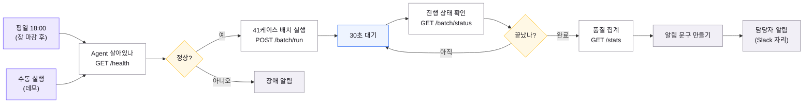

# n8n — 야간 배치 오케스트레이션

## 경계

**n8n 은 오케스트레이션이고 Agent 는 판단이다.**

| n8n 이 하는 것 | Agent 가 하는 것 |
|---|---|
언제 돌릴지 (평일 18:00) | 무엇을 쓸지 |
Agent 가 살아 있는지 확인 | 통과시킬지 (3축 심사) |
진행 상태 폴링 | 재작성할지 · 폴백할지 |
끝나면 누구에게 알릴지 | |
실패하면 장애 알림 | |

이 경계를 흐리면 둘 다 나빠집니다. n8n 안에 판단 로직을 넣으면 테스트할 수
없고, Agent 안에 스케줄을 넣으면 운영이 코드 배포에 묶입니다.

```
평일 18:00 ─┐
            ├→ /health → 정상? ─┬→ /batch/run → 30초 대기 ⟲ /batch/status
수동 실행 ──┘                   │                            └→ 끝났나?
                                │                                 └→ /stats
                                │                                      └→ 알림
                                └→ 장애 알림
```

## 실행

### 1. Agent API 먼저

```bash
./run_local.sh mcp &      # 시황·뉴스 Tool
./run_local.sh api        # 127.0.0.1:8900  (문서 /docs)
curl localhost:8900/health
```

### 2. n8n

```bash
./run_local.sh n8n        # npx n8n → http://localhost:5678
```

처음 뜨면 계정을 하나 만들라고 합니다 (로컬 전용, 아무 값이나).

> **첫 실행은 10분 이상 걸립니다** (langchain 포함 500MB). 설치가 끝나야
> 서버가 뜹니다. **자기 터미널에서 돌리세요** — 다른 프로세스가 셸을
> 정리하면 설치가 중단됩니다.

#### ⚠️ Node 24 가 필요합니다

n8n 2.x 는 `node >= 24` 를 요구합니다. Node 20 에서는 설치는 되지만
**경고 더미 끝에 이 줄이 뜨고 실행되지 않습니다.**

```
npm WARN EBADENGINE Unsupported engine {
npm WARN EBADENGINE   package: 'n8n@2.43.4',
npm WARN EBADENGINE   required: { node: '>=24.0.0' },
npm WARN EBADENGINE   current: { node: 'v20.10.0' }
```

경고가 수백 줄이라 이 한 줄을 놓치기 쉽습니다. **`EBADENGINE` 만 보세요.**

```bash
nvm install 24          # 한 번만
./run_local.sh n8n      # 이후로는 알아서 24 로 바꿔 띄웁니다
```

`run_local.sh` 가 nvm 을 찾아 Node 24 로 전환하고, 24 가 없으면 설치하라고
알려줍니다. 시스템 Node 는 20 그대로 둬도 됩니다 — 파이썬 쪽과 무관합니다.

#### npx 가 실패하면 — npm 캐시 손상

```
npm ERR! code ENOENT ... _cacache/content-v2/...
```

실제로 겪었습니다. 캐시를 비우고 다시 받으면 됩니다.

```bash
npm cache clean --force
./run_local.sh n8n
```

#### Docker 로 돌릴 때

```bash
docker run -it --rm -p 5678:5678 \
  -v n8n_data:/home/node/.n8n docker.n8n.io/n8nio/n8n
```

컨테이너 안의 `127.0.0.1` 은 호스트가 아닙니다. **HTTP 노드 4개의 주소를
`host.docker.internal` 로 바꾸세요** — `Agent 살아있나` · `41케이스 배치 실행` ·
`진행 상태 확인` · `품질 집계`.

API 도 밖으로 열어야 합니다.

```bash
API_HOST=0.0.0.0 ./run_local.sh api
```

> 처음엔 주소를 `{{ $env.BRIEFING_API }}` 로 받게 했다가 되돌렸습니다.
> n8n 은 기본적으로 노드에서 환경변수 접근을 막아
> **`access to env vars denied`** 가 납니다
> (`N8N_BLOCK_ENV_ACCESS_IN_NODE`). 플래그를 하나 더 켜게 하느니
> URL 네 개를 손으로 고치는 쪽이 낫습니다.

### 3. 워크플로 가져오기

n8n 화면 우측 상단 **⋯ → Import from File** → `n8n/briefing_batch.json`

### 4. 돌려보기

**수동 실행 (데모)** 노드를 누르고 **Execute workflow**.
18:00을 기다릴 수 없으니 데모용 트리거를 따로 뒀습니다.

마지막 노드 출력에 이런 알림이 뜹니다.

```
[디지털PB 브리핑] 야간 배치 정상

생성 41건 · 검수 대기 41건 · 오류 0건
폴백 0건 · 평균 심사 1.22회차 · 955.8초

심사 반려  컴플라이언스 0 / 근거 0 / 형식 1

검수: http://localhost:8501  (모드: 담당자 검수)
```

> 41건은 약 16분입니다. 발표 리허설에서는 `41케이스 배치 실행` 노드의
> `jsonBody` 를 `{"limit": 3, "auto_approve": false}` 로 바꾸세요.

## 워크플로 — 12노드

n8n 을 띄우지 못할 때 **이 다이어그램을 슬라이드에 써도 됩니다.**
`briefing_batch.json` 과 1:1로 대응합니다.



| 노드 | 하는 일 |
|---|---|
평일 18:00 | 장 마감 후 자동 실행. 주말 제외 (`0 18 * * 1-5`) |
수동 실행 | 발표용. 18시를 기다릴 수 없다 |
Agent 살아있나 | 죽어 있으면 배치를 안 돌린다. 빈 큐가 쌓이는 것보다 낫다 |
41케이스 배치 실행 | 즉시 202. 16분을 동기로 기다리면 타임아웃 |
30초 대기 ⟲ 진행 상태 | 폴링 루프 |
품질 집계 | 알림 문구에 넣을 숫자 |
알림 문구 만들기 | 폴백 3건 초과 또는 오류면 "확인 필요"로 올린다 |
담당자 알림 | Slack 노드로 바꾸면 바로 운영 |

## API 엔드포인트

| | | |
|---|---|---|
`GET` | `/health` | 살아 있는지 + Tool 경로 |
`POST` | `/batch/run` | 배치 시작 (즉시 202, 백그라운드 실행) |
`GET` | `/batch/status` | `queued` → `running` → `done` |
`GET` | `/pending` | 검수 대기 목록 |
`POST` | `/approve/{case}` | 승인 — `{"by": "이예나"}` |
`POST` | `/reject/{case}` | 반려 — `{"by": "...", "reason": "..."}` |
`GET` | `/stats` | 품질 집계 (알림 문구용) |

`/docs` 에 OpenAPI 문서가 자동으로 뜹니다.

## 설계에서 걸린 것

**① 배치가 16분이라 동기로 받을 수 없다.**
`/batch/run` 은 즉시 202 로 돌아오고 n8n 이 `/batch/status` 를 폴링합니다.
동기로 두면 n8n HTTP 노드가 타임아웃 납니다.

**② 응답 전에 상태를 바꿔야 한다.**
FastAPI `BackgroundTasks` 는 **응답을 보낸 뒤** 실행됩니다. `/batch/run` 안에서
`state="queued"` 로 먼저 바꾸지 않으면, 폴링하는 쪽이 아직 `idle` 을 보고
**"벌써 끝났다"고 판단**합니다. 실제로 이 함정에 빠졌습니다.

**③ 체크포인터가 `InMemorySaver` 다.**
배치를 돌린 **그 프로세스 안에서만** 검수 재개가 됩니다. API 를 재시작하면
대기건이 날아갑니다. 그래서 그래프를 `ba.get_app()` 싱글턴으로 공유합니다.
운영은 `SqliteSaver` 로 바꿔 프로세스 경계를 넘어야 합니다.

## ⚠️ 이 API 는 Batch 전용

고객 요청 경로가 **아닙니다.** 금소법상 투자 문구는 사람 책임 하에 노출되어야
하므로 고객 진입 시점에는 승인된 JSON 만 읽습니다.
`/customer/briefing` 같은 엔드포인트를 만들지 마세요.
